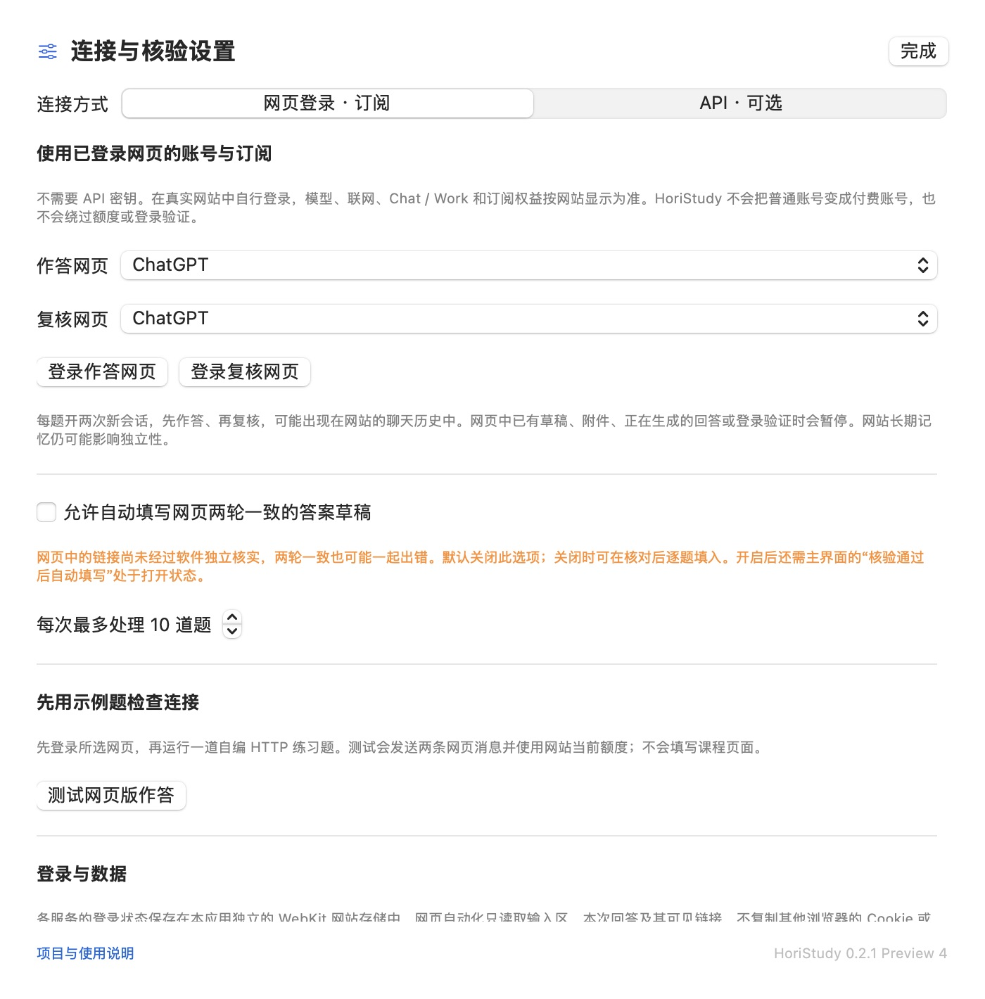

# HoriStudy 学伴

原生 macOS 学习通网页助手：题目识别、登录 AI 网页作答、新会话复核、已核对题库、自动填写、逐题翻页和课程视频连续播放。默认使用网页登录，可以打开 ChatGPT、DeepSeek、豆包和 Gemini，使用网站当前提供的账号与订阅权益；API 为可选连接方式。

**0.2.2 Preview 5 是适配预览版，无法承诺答案全对。** 156 项本地检查通过，包括真实 WebKit 中的自建聊天、课程和登录页面。2026-10-19 已在 HoriStudy 内验证 ChatGPT 真实账号登录、重启后保留登录，以及 Chat 和 Work 模式各自完成“发送示例题 → 读回 → 新会话复核 → 两轮一致”的流程；未调用 API。Preview 5 继续修正学校自定义域名的登录跳转。证据范围见 [验证记录](docs/VERIFICATION.zh-CN.md)。其他服务的账号、真实学生作业、在线考试及课程进度仍需分别验收。



## 下载与运行

- 从 [GitHub Releases](https://github.com/hhhoratioxu/HoriStudy/releases) 下载 macOS 安装包。
- 需要 macOS 14 或更新版本；通用版本包含 Apple Silicon 与 Intel 架构，当前只在 Apple Silicon Mac 上运行验证。
- 解压后将 `HoriStudy.app` 拖进“应用程序”，双击打开。
- 预览版使用本地临时签名，未获得 Apple Developer ID 公证。若 macOS 拦截，请在确认来源后通过系统“隐私与安全性”的“仍要打开”完成授权。软件不会自动关闭 Gatekeeper。

## 使用

1. 打开 HoriStudy，点击“打开学习通”，在内置浏览器中自行登录。也可以在地址栏输入你的学校课程 HTTPS 地址。课程自动识别只对 `chaoxing.com` 和 `xueyinonline.com` 及其子域名启用。
2. 打开具体的作业、试卷或章节测验页面，点击“识别当前页”。只显示能识别的题目，不会导出账号、Cookie 或整页内容。
3. 在设置中选择“网页登录 · 订阅”，分别选择作答和复核服务，点击“登录作答网页”“登录复核网页”，在网站中自行登录。也可点击主界面的“AI 网页”。模型、联网和 Chat / Work 模式在真实网页中选择；本软件不授予额外会员或额度。
4. 先点击“测试网页版作答”，用自编示例题检查当前页面。随后回到课程页面，点击“开始核验”。软件优先匹配题干、题型及完整选项一致的本地题库；没有命中时发送给所选 AI 网页，再开启新会话复核。右侧显示选项、解析、回答来源及暂停原因。
5. 默认自动填写通过核验的题库或 API 查证答案。**网页回答默认是待核对草稿**：可以核对后逐题填入；也可在设置中开启“允许自动填写网页两轮一致的答案草稿”，同时保留主界面的自动填写开关。两轮不一致、含歧义或返回格式错误时仍会暂停。本页全部填写并读回确认后，尝试进入下一题；默认每次最多 10 道。
6. **提交前检查全部网页答案**，点击“提交此页…”。如果网页还有自己的确认窗口或验证码，请在网页中完成。软件点击按钮后不会将其描述成“已经提交成功”。

登录或课程入口如果弹出新网页，会在应用内显示新标签页，原页面和登录会话保留。登录页需要回调原页面时可以正常通信；关闭新页会返回原页。地址栏右侧的“登录诊断”显示本机记录的协议、主机名与错误码，可以区分手机 App 唤起、被取消的跳转和真实加载错误。

部分学校在登录后跳转到学校自己的域名，旧链接仍使用 HTTP。Preview 5 会将主页面跳转升级为 HTTPS，保留路径和参数，并继续正常校验证书；HTTPS 失败时不会退回明文。学校自定义域名不会因此获得题目识别或自动填写权限，课程自动化仍只在上述超星可信域名中运行。

若手机提示扫码“二维码过期或无效”，先点击 HoriStudy 地址栏旁的刷新按钮，再用学习通 App 扫当前软件窗口中的新码，并在手机确认登录。之前的聊天截图、另一个窗口或已经停留较久的二维码不能替代当前窗口的新码。请以网页实际进入课程主页为登录成功依据。

## 网页登录与订阅

四家入口分别保留独立的本应用网站存储。只发送识别出的题目数据，不复制 Safari/Chrome 登录 Cookie，不读取或导出网页账号令牌。已登录网站能使用哪些模型、Chat / Work 模式、联网工具和额度，以该网站和账号实际提供的功能为准。

每轮使用新会话，发送一次带随机题目标识的提示，并等待该题回答的完整 JSON 和页面完成标记；超时不会自动重发。新会话可能出现在网站历史记录中，网站的长期记忆仍可能影响独立性。遇到已识别的草稿、附件、正在生成的回答、登录或验证码时会暂停。暂停本机自动化不会保证已经发出的网页请求停止生成，需要时请在网站点停止。

ChatGPT 匿名会话如果需要“清除当前聊天”才能开始复核，软件会暂停并提示登录，不会代替你确认清除。第一轮已读回而复核未完成时，会保留第一轮为待核对草稿。连接测试的失败和取消也会明确显示暂停状态。

网页登录不是稳定 API。网站可能限制内嵌浏览器登录或改变页面结构。本次 ChatGPT 登录由用户在 HoriStudy 的官方网页登录窗口自行完成。2026-10-17 的独立浏览器检查中，Gemini 显示输入区、DeepSeek 要求登录、豆包显示页面暂时不可用；这些是历史观察，**不是 HoriStudy 已打通其余三家账号的证据**。

如果网站不接受内嵌登录，或自动发送/读取无法完成，可以在默认浏览器中使用“复制本题提示”，手动发送后复制完整 JSON，通过“导入复制的回答”读回；题目标识不匹配时会拒绝导入。导入的单轮回答不会自动变成已核验答案。

## 可选 API 接入

在设置中切换到“API · 可选”，可分别配置作答和复核服务。密钥只在软件设置里填写，分别保存在本机钥匙串；不要发到聊天或 GitHub Issue。

| 服务 | 接口及模型设置 |
| --- | --- |
| OpenAI（ChatGPT） | 官方 Responses API；保留已有 OpenAI 钥匙串配置，默认模型 `gpt-5.4`，可改成账号可用模型 |
| DeepSeek | 官方 Chat Completions API，默认 `deepseek-flash`，需要该服务自己的 API 密钥 |
| 豆包 · 火山方舟 | 官方 Chat Completions API，默认 `doubao-seed-2-1-pro-260915`；也可填写自己的模型或推理接入点 ID |
| 自定义兼容接口 | HTTPS Base URL、模型 ID、独立密钥；可关闭 JSON Object 请求参数，但返回仍需符合答案格式 |

只配置一家作答与复核服务即可生成草稿，每题 2 次请求。可额外开启“联网查证（使用 OpenAI）”，使用 OpenAI 密钥及支持 `web_search` 的检索模型查资料，再交给所选作答、复核服务，共 3 次请求。没有实际检索来源的 API 草稿不会自动填写。请求按相应 API 账号计费，软件不会创建密钥或修改账单。各家账号的可用模型及权限需要实际验证；本地 API 检查使用模拟响应，没有调用付费 API。

内置三家的 API 地址固定；自定义密钥绑定到规范化后的精确 Base URL，修改地址不会沿用旧地址的密钥。API 请求阻止重定向，不转发浏览器 Cookie。

在视频页面点击“连续播放”。播放器按正常方式播放，软件不跳到结尾、不伪造观看日志，也不改写网站限制。可选“页面确认任务完成后进入下一节”：只有本页全部视频结束、等待回写、页面任务标记明确显示完成，并且可以唯一识别下一节按钮时才会切换。遇到验证码、监考/人脸提示、特殊播放器或无法判断的进度时需要你处理。

## 准确性设计及限制

| 检查 | 行为 |
| --- | --- |
| 导入题库 | 精确匹配题干、题型和全部选项；按选项内容定位，选项顺序变化不会直接套用旧字母 |
| 网页作答 | 本次随机标识、完整格式、网站完成标记和新会话复核；网页链接只表示在本次回答中出现，未独立核验其内容或检索过程 |
| 题库出现互相冲突的答案 | 暂停该题 |
| 联网查证 | 要求真实完成 `web_search`，从 API 的引用标注中提取来源；不接受模型自行编造的来源 ID |
| 两轮核对 | 第二轮不看第一轮答案，比较完整选项集合或有序填空；**同模型、同来源仍可能一起出错** |
| 自动填写 | 题干和选项必须与查题时完全一致；页面已有不同答案时停止，不静默覆盖 |
| 写入后的确认 | 读回选项和文本框状态；无法确认时标为“填写待核对” |
| 图片、图片公式、未识别题型 | 不猜答案，不自动填写 |
| 主观题、连线、排序、阅读组合题、特殊富文本编辑器 | 只在能完整识别题型及输入框时处理，其余暂停；不承诺覆盖所有版式 |
| 最终提交 | 由你复核后明确触发，并以网站回执为准 |

同一模型、同一资料、新会话乃至不同服务都可能一起出错；两轮一致不是正确率保证。网站未提供的联网能力或付费功能不会由本软件补齐。API 额度、模型权限或格式错误会暂停，不自动无限重试。

本软件不会创建 API 密钥、修改 API 账单、读取已有浏览器的账号数据、自动处理验证码或人脸识别，也不保证平台规则允许你的使用方式。请按课程和考试要求使用。

## 本地题库

通过“导入…”选择 UTF-8 JSON，导入后替换当前题库。字段及示例见 [example-bank.json](Resources/example-bank.json)。来源需要可点击的 HTTPS 链接，答案用**选项完整文本**表示，不用 A/B 字母。每个简答条目返回一个文本答案，填空按空格顺序返回。

示例题库只包含自编的 HTTP 状态码练习题，未附带任何学校的试题或商业题库。

## 隐私

- 登录信息由本应用的 WebKit 网站数据存储管理；不复制 Safari/Chrome 的 Cookie。
- API 密钥按服务分别保存在 macOS 钥匙串，不回显已存密钥。网页脚本在单独的 WebKit 内容世界里运行，不接收 API 密钥。
- 网页模式向所选网站发送题目，可能保存在该网站的聊天历史中；本应用本地识别结果默认在内存中。
- API 模式向所选服务发送题干、题型、选项、空格数及已有检索资料；可选检索还会向 OpenAI 发送题目。OpenAI 请求设置 `store: false`，这不代表供应商不存在其他数据保留政策。
- 题目与核验结果默认只留在内存；手动导出的 JSON 会含题目和答案，请自行保管。
- 导入题库存放在本机 `~/Library/Application Support/HoriStudy/answer-bank.json`；删除应用不会自动删除钥匙串和网站数据。可以先在设置中移除密钥，再通过系统文件管理器清理本应用数据。
- 不包含统计、广告或自建遥测服务。公开源码与安装包不应包含个人账号、题目记录、Cookie 或密钥。
- 本机登录诊断保存在 `~/Library/Logs/HoriStudy/navigation.jsonl`，只记录协议、主机名、事件类型与错误码，不记录路径、查询参数、表单、网页内容或 Cookie。日志有大小上限，不会自动上传。公开 Issue 中也不应附带学校内部主机等你不希望公开的信息。

## 从源码构建

使用 Apple 的 Swift、SwiftUI、AppKit、WebKit 和 Security 框架，没有第三方运行库依赖。

```sh
zsh scripts/build.sh                 # 当前 Mac 架构
zsh scripts/build.sh --universal     # arm64 + x86_64
zsh scripts/test.sh                  # 核心规则和真实 WebKit 本地检查
open build/HoriStudy.app
zsh scripts/package.sh              # ZIP、DMG 与 SHA-256
```

构建需要已安装的 Apple 开发工具。脚本优先使用已安装的完整 Xcode Swift 工具链及匹配 SDK，必要时回退到 Command Line Tools；不会代替你接受 Xcode 许可证或更改系统配置。本版本未启用 GitHub Actions：当前 GitHub 授权不包含写入工作流的权限。构建配置保留为 [macos-ci.example.yml](docs/macos-ci.example.yml)，可由仓库所有者自行启用。已交付安装包来自本地构建与验证。

## 项目说明

- 本项目与超星、学习通及所列 AI 服务无隶属关系。
- 代码为本项目原创实现。适配时参考了公开页面的常见 DOM 标记；未打包或依赖其他网课脚本。参考资料和限制见 [开发说明](docs/DEVELOPMENT.md)。
- MIT License。欢迎反馈不含账号和题目隐私的版式问题；请不要在公开 Issue 粘贴个人试卷、密钥或登录链接。
