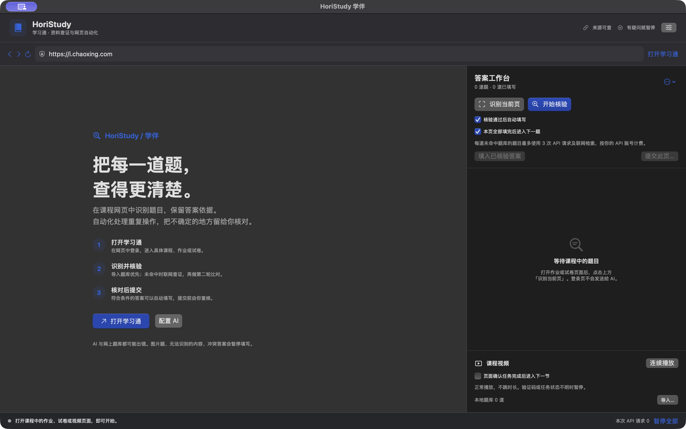

# HoriStudy 学伴

原生 macOS 学习通网页助手：题目识别、已核对题库、OpenAI 联网查证、两轮答案比对、自动填写、逐题翻页和课程视频连续播放。

**0.1.1 Preview 2 是适配预览版。无法承诺答案全对，也尚未完成真实学生账号上的作业、考试和课程进度验收。** 本地测试使用真实 WebKit 与自建页面；这不等于已经验证学校的在线试卷。详见 [验证记录](docs/VERIFICATION.zh-CN.md)。



## 下载与运行

- 从 [GitHub Releases](https://github.com/hhhoratioxu/HoriStudy/releases) 下载 macOS 安装包。
- 需要 macOS 14 或更新版本；通用版本包含 Apple Silicon 与 Intel 架构，当前只在 Apple Silicon Mac 上运行验证。
- 解压后将 `HoriStudy.app` 拖进“应用程序”，双击打开。
- 预览版使用本地临时签名，未获得 Apple Developer ID 公证。若 macOS 拦截，请在确认来源后通过系统“隐私与安全性”的“仍要打开”完成授权。软件不会自动关闭 Gatekeeper。

## 使用

1. 打开 HoriStudy，点击“打开学习通”，在内置浏览器中自行登录。也可以在地址栏输入你的学校课程 HTTPS 地址。课程自动识别只对 `chaoxing.com` 和 `xueyinonline.com` 及其子域名启用。
2. 打开具体的作业、试卷或章节测验页面，点击“识别当前页”。只显示能识别的题目，不会导出账号、Cookie 或整页内容。
3. 设置中填入**你自己的 OpenAI API 密钥**，保存到本机钥匙串；或导入你已经核对过的 JSON 题库。不要把密钥发在聊天或 GitHub Issue 中。
4. 点击“开始核验”。软件优先匹配题干、题型及完整选项一致的本地题库；没有命中时调用联网检索，再分别请求答案和第二轮核对。右侧可以查看选项、解析、来源和暂停原因。
5. 默认自动填写通过核验的答案，本页全部题目填写并读回确认后，尝试进入下一题。每次默认最多处理 10 道题，可在设置中调整。
6. **提交前检查全部网页答案**，点击“提交此页…”。如果网页还有自己的确认窗口或验证码，请在网页中完成。软件点击按钮后不会将其描述成“已经提交成功”。

登录或课程入口如果弹出新网页，会在应用内显示新标签页，原页面和登录会话保留。登录页需要回调原页面时可以正常通信；关闭新页会返回原页。地址栏右侧的“登录诊断”显示本机记录的协议、主机名与错误码，可以区分手机 App 唤起、被取消的跳转和真实加载错误。

在视频页面点击“连续播放”。播放器按正常方式播放，软件不跳到结尾、不伪造观看日志，也不改写网站限制。可选“页面确认任务完成后进入下一节”：只有本页全部视频结束、等待回写、页面任务标记明确显示完成，并且可以唯一识别下一节按钮时才会切换。遇到验证码、监考/人脸提示、特殊播放器或无法判断的进度时需要你处理。

## 准确性设计及限制

| 检查 | 行为 |
| --- | --- |
| 导入题库 | 精确匹配题干、题型和全部选项；按选项内容定位，选项顺序变化不会直接套用旧字母 |
| 题库出现互相冲突的答案 | 暂停该题 |
| 联网查证 | 要求真实完成 `web_search`，从 API 的引用标注中提取来源；不接受模型自行编造的来源 ID |
| 两轮核对 | 第二轮不看第一轮答案，比较完整选项集合或有序填空；**同模型、同来源仍可能一起出错** |
| 自动填写 | 题干和选项必须与查题时完全一致；页面已有不同答案时停止，不静默覆盖 |
| 写入后的确认 | 读回选项和文本框状态；无法确认时标为“填写待核对” |
| 图片、图片公式、未识别题型 | 不猜答案，不自动填写 |
| 主观题、连线、排序、阅读组合题、特殊富文本编辑器 | 只在能完整识别题型及输入框时处理，其余暂停；不承诺覆盖所有版式 |
| 最终提交 | 由你复核后明确触发，并以网站回执为准 |

可配置答案模型和复核模型，默认 `gpt-5.4`。答案模型需要支持 Responses API、`web_search` 和结构化输出，复核模型需要支持结构化输出。未命中题库时，每题包含 3 次 API 请求及联网检索，**按你的 API 账号计费**。额度、权限或格式错误会暂停，不自动无限重试。

本软件不会创建 API 密钥、修改 API 账单、读取已有浏览器的账号数据、自动处理验证码或人脸识别，也不保证平台规则允许你的使用方式。请按课程和考试要求使用。

## 本地题库

通过“导入…”选择 UTF-8 JSON，导入后替换当前题库。字段及示例见 [example-bank.json](Resources/example-bank.json)。来源需要可点击的 HTTPS 链接，答案用**选项完整文本**表示，不用 A/B 字母。每个简答条目返回一个文本答案，填空按空格顺序返回。

示例题库只包含自编的 HTTP 状态码练习题，未附带任何学校的试题或商业题库。

## 隐私

- 登录信息由本应用的 WebKit 网站数据存储管理；不复制 Safari/Chrome 的 Cookie。
- OpenAI 密钥只保存在 macOS 钥匙串。注入网页的脚本在单独的 WebKit 内容世界里运行，不接收密钥。
- 主动核验时向 `https://api.openai.com/v1/responses` 发送题干、题型、选项和空格数；联网搜索会使用相关搜索词。请求设置 `store: false`，这不代表供应商不存在其他数据保留政策。
- 题目与核验结果默认只留在内存；手动导出的 JSON 会含题目和答案，请自行保管。
- 导入题库存放在本机 `~/Library/Application Support/HoriStudy/answer-bank.json`；删除应用不会自动删除钥匙串和网站数据。可以先在设置中移除密钥，再通过系统文件管理器清理本应用数据。
- 不包含统计、广告或自建遥测服务。公开源码与安装包不应包含个人账号、题目记录、Cookie 或密钥。
- 本机登录诊断保存在 `~/Library/Logs/HoriStudy/navigation.jsonl`，只记录协议、主机名、事件类型与错误码，不记录路径、查询参数、表单、网页内容或 Cookie。日志有大小上限，不会自动上传。公开 Issue 中也不应附带学校内部主机等你不希望公开的信息。

## 从源码构建

使用 Apple 的 Swift、SwiftUI、AppKit、WebKit 和 Security 框架，没有第三方运行库依赖。

```sh
zsh scripts/build.sh                 # 当前 Mac 架构
zsh scripts/build.sh --universal     # arm64 + x86_64
zsh scripts/test.sh                  # 核心规则和真实 WebKit 本地检查
open build/HoriStudy.app
zsh scripts/package.sh              # ZIP、DMG 与 SHA-256
```

构建需要已安装的 Apple 开发工具。脚本优先使用已安装的完整 Xcode Swift 工具链及匹配 SDK，必要时回退到 Command Line Tools；不会代替你接受 Xcode 许可证或更改系统配置。本版本未启用 GitHub Actions：当前 GitHub 授权不包含写入工作流的权限。构建配置保留为 [macos-ci.example.yml](docs/macos-ci.example.yml)，可由仓库所有者自行启用。已交付安装包来自本地构建与验证。

## 项目说明

- 本项目与超星、学习通及 OpenAI 无隶属关系。
- 代码为本项目原创实现。适配时参考了公开页面的常见 DOM 标记；未打包或依赖其他网课脚本。参考资料和限制见 [开发说明](docs/DEVELOPMENT.md)。
- MIT License。欢迎反馈不含账号和题目隐私的版式问题；请不要在公开 Issue 粘贴个人试卷、密钥或登录链接。
